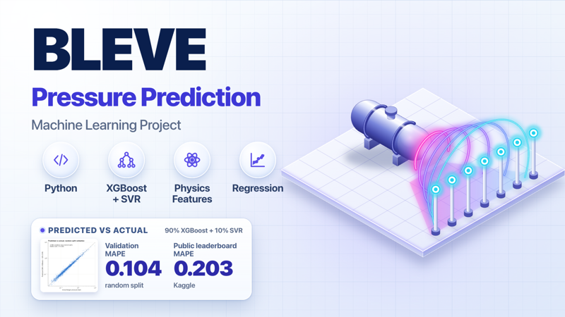
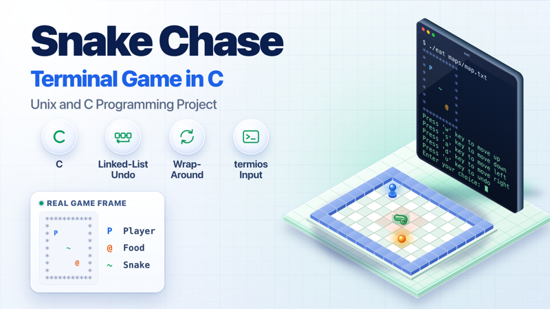
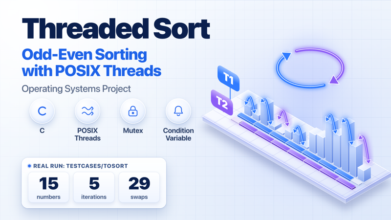
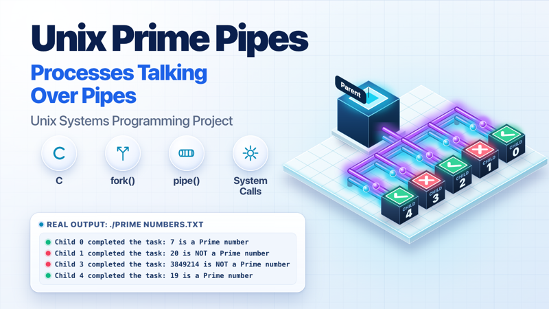

# Saumya Fernando

I'm a computing student at Curtin University. I build software by directing AI agents with Claude Code.

## Projects

### BLEVE

Predicts peak blast pressure of a boiling liquid expanding vapour explosion with an XGBoost and SVR blend. Validation MAPE is 0.104 on a random split, which is optimistic. Public Kaggle MAPE is 0.20272.

Stack: Python, XGBoost, scikit-learn.

Curtin coursework. Code is private.

### Snake Chase

A terminal game in C. Reach the food before the snake catches you on a wrap-around grid. Undo uses a linked list. Some helper files came from the unit.

Stack: C89, termios, Make.

Curtin coursework. Code is private.

### Threaded Sort

Odd-even sort of up to 200 integers on two POSIX threads, taking turns with a mutex and a condition variable.

Stack: C, POSIX threads, Make.

Curtin coursework. Code is private.

### Unix Prime Pipes

Tests each integer in a file for primality in its own child process, reporting back over pipes.

Stack: C99, Make.

Curtin coursework. Code is private.

## How I work

I plan first, then give each task to its own sub-agent. Matching model to task keeps usage down.

| Model | Used for |
|---|---|
| Opus | Planning, architecture, security judgement, final review |
| Sonnet | Code edits, tests, docs, builds |
| Haiku | Lookups, searches, summaries |

## Feedback

Open an issue on this repo with thoughts on the profile or projects.
